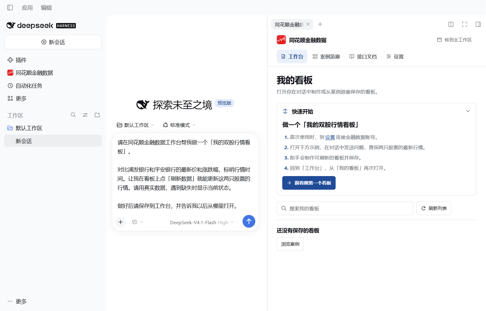
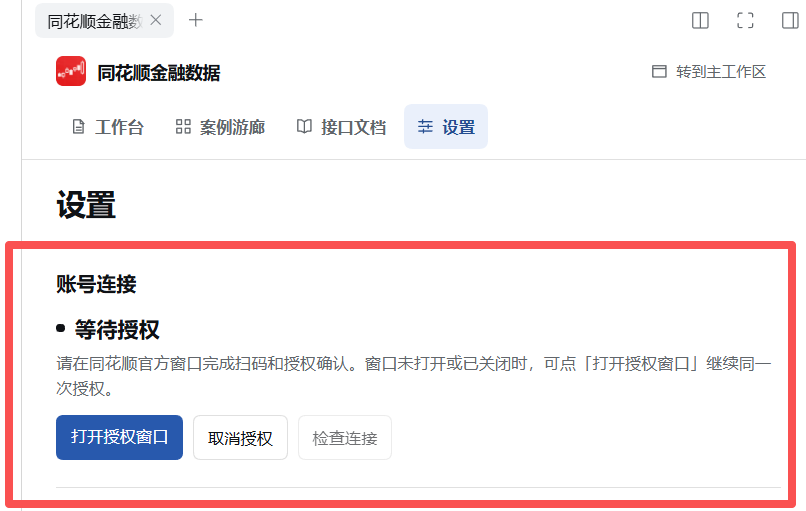
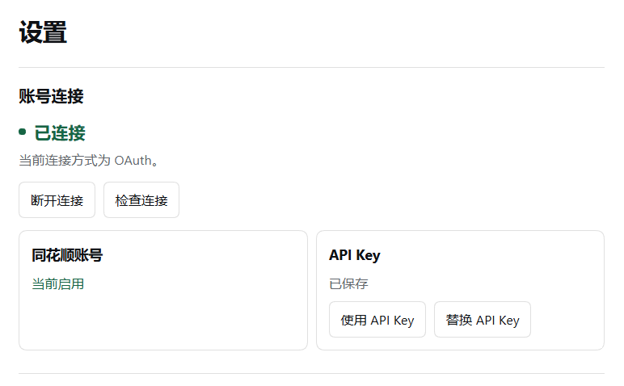
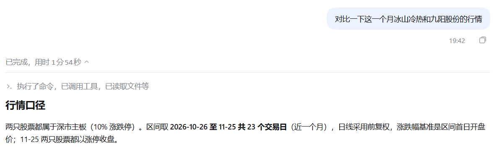
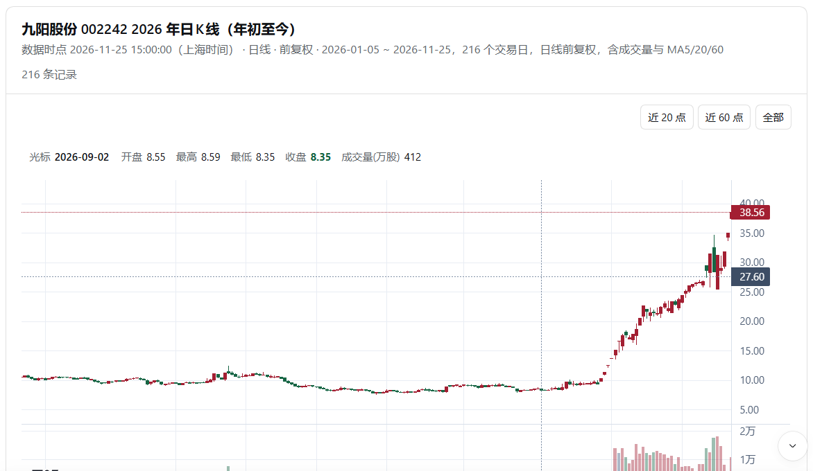
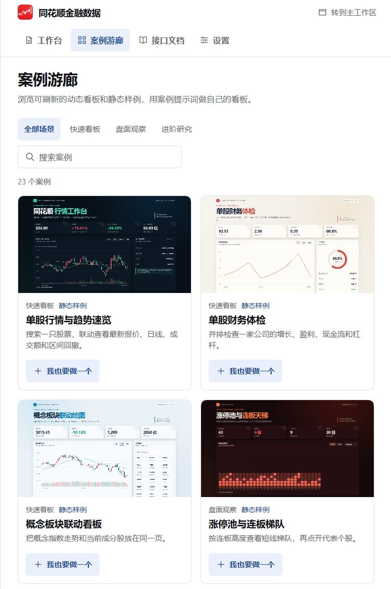
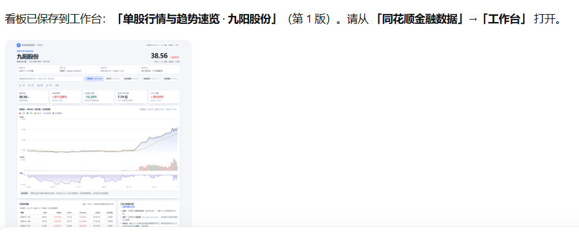
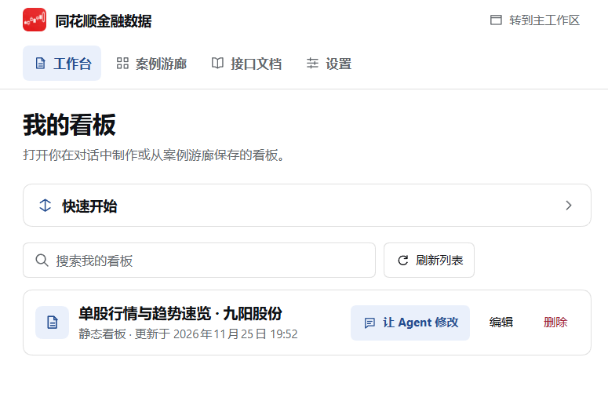
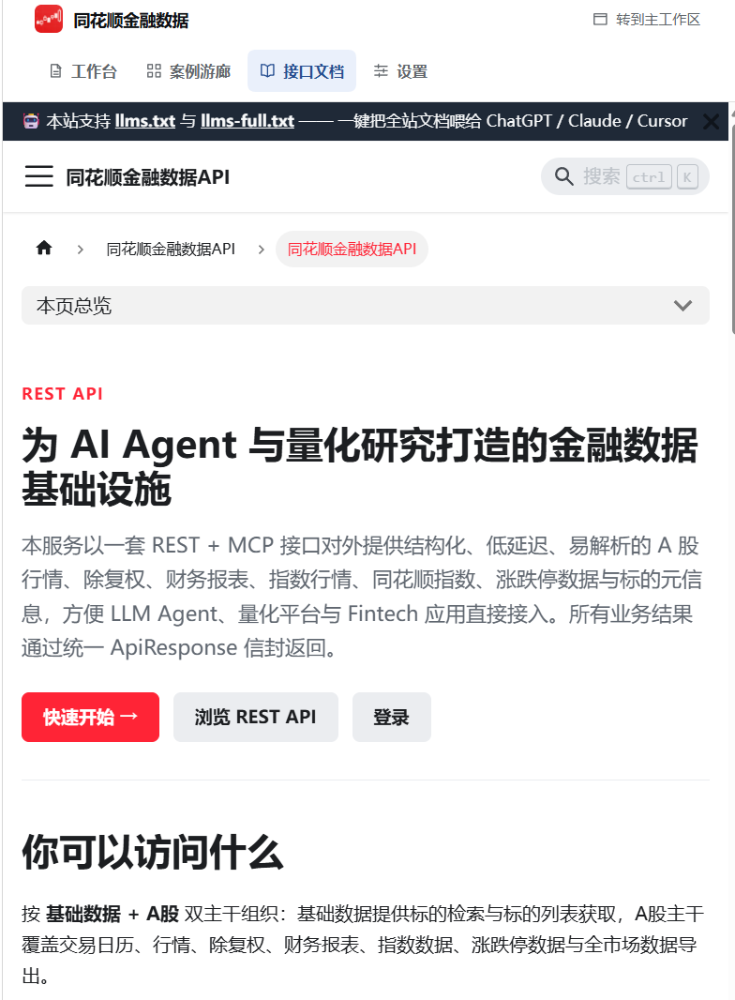
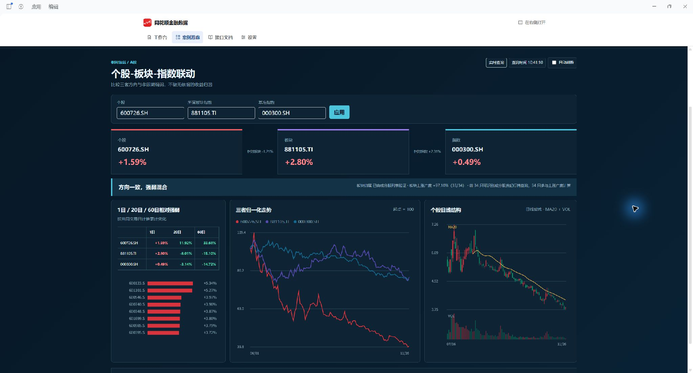

# 同花顺金融数据 · DeepSeek Harness 插件

在 DeepSeek Harness（DSH）里，用自然语言查询同花顺金融数据，直接在对话中查看行情、财报和图表。还可以把查询做成工作台看板，下次打开继续看、刷新或修改。

[功能说明](#功能说明) · [安装](#安装) · [快速开始](#快速开始) · [动态案例](#从动态案例开始)

## 功能说明

### 在右侧打开工作台

点击 DSH 左侧的「同花顺金融数据」，右侧会与对话并排显示工作台、案例游廊、接口文档和设置。要仔细看图时点「转到主工作区」，点「在右侧打开」可回到对话旁。

第一次制作看板时，在「工作台 → 我的看板」点击「跟着做第一个看板」。示例提示词会出现在对话输入框，可以先换成关注的标的，再发送。



### 用 OAuth 或 API Key 连接账号

在「设置 → 账号连接」点击「连接账号」，即可打开同花顺官方 OAuth 授权窗口，扫码并确认。等待授权时，侧栏会显示状态，可以点「打开授权窗口」继续，或点「取消授权」。



也可以在设置中输入 API Key，验证通过后即可取数。两种方式都保存时，可以从设置切换当前连接。凭据与同一系统用户下的同花顺金融数据 CLI 共用，切换或断开会同步影响该用户的其他 CLI 会话。



### 在对话里问行情，直接看图表卡片

直接说出想看的标的、区间和问题，Agent 会用同花顺金融数据 CLI 的领域 Skills 取数、计算并说明口径。下图是用户在 DSH 中询问冰山冷热与九阳股份近一个月行情的实际对话。 [CLI 能力说明](../../hithink-finance-cli/README.md)



同一个会话可以继续追问，使用行情快照、K 线与成交量、折线、排名、财务对比或数据表展示结果。下图是九阳股份的日 K 卡片。移动十字光标可核对单日开高低收和成交量，也可切换观察窗口、拖动或缩放时间轴。卡片的数据表可用来核对明细。



### 从案例游廊带入创作提示词

案例游廊收录同花顺金融数据的官网最佳实践，可以按场景浏览或搜索。静态样例适合参考布局和分析方式，动态看板用当前连接的金融数据账号取数，支持切换条件和刷新。

点「我也要做一个」，对应的提示词会填入对话框。补充你要看的股票、日期和指标，再发送给 Agent。



### 生成、保存和修改自己的看板

以「单股行情与趋势速览」为例，在案例提示词里补充要看九阳股份，Agent 可以做出包含收盘价、均线、成交额和回撤的看板。下图是会话里显示的保存结果。



在「工作台 → 我的看板」搜索名称即可回访。点「让 Agent 修改」会在对话中引用这张看板，补充修改要求后发送即可继续调整。需要每次重新取数时，可以让 Agent 制作动态看板，打开后用「刷新数据」更新。



作品可以在切换会话或重启 DSH 后再次打开。「设置 → 看板目录」可以切换保存位置，并选择是否复制当前作品。相同作品会跳过，遇到内容冲突时会提示处理。

### 在端内查看接口文档

点击「接口文档」，就能在 DSH 中查看同花顺金融数据官网，核对接口用途、参数和返回字段。 [官网接口文档](https://fuyao.aicubes.cn/docs/)



## 安装

插件包名为 `@hithink-tech/dsh-finance`。支持 DSH 0.2.0 及以上版本，以及从 0.2.0-rc.1 起的兼容预发布版本。Windows 上已验证 DSH Web 和官方 DSH Desktop。下载安装包后按下列步骤操作，安装时需要联网获取依赖。 [下载插件 0.1.0](https://github.com/Hithink-Tech-Org/Financial-API/releases/download/v0.2.5/hithink-tech-dsh-finance-0.1.0.tgz) · [从源码构建](#从源码构建)

### Windows Desktop

1. 启动一次官方 DSH Desktop，然后通过应用菜单或托盘完全退出。
2. 打开 PowerShell，使用 Desktop 自带的 `dsh.cmd` 安装。将示例中的应用目录和安装包路径替换成实际路径。

   ```powershell
   & 'C:\Program Files\DeepSeek Harness\resources\runtime\cli\bin\dsh.cmd' plugin --profile desktop add 'D:\Downloads\hithink-tech-dsh-finance-0.1.0.tgz' --ignore-scripts
   ```

3. 重新打开 Desktop，进入「插件 → 已安装」，找到「同花顺金融数据」并启用。左侧出现「同花顺金融数据」后，点击打开工作台。 [DSH Desktop 内置命令说明](https://github.com/deepseek-ai/deepseek-harness/blob/master/apps/desktop/README.zh.md#内置命令运行时)

### DSH Web

1. 按 DSH 官方说明准备 Web 所需的 Node.js 和 pnpm，使终端能运行 `dsh --version`。 [DSH Web 入门](https://deepseek-harness.github.io/deepseek-harness/guide/quickstart)
2. 执行下面的命令，将 `.tgz` 替换为实际路径。已有 Web 实例时，安装后重启该实例。

   ```sh
   dsh plugin --profile web add ./hithink-tech-dsh-finance-0.1.0.tgz --ignore-scripts
   dsh web
   ```

3. 打开 `dsh web` 输出的地址。在「插件 → 已安装」确认「同花顺金融数据」已启用，再从左侧打开工作台。

同时使用 Web 和 Desktop 时，分别安装到 `web` 和 `desktop` 配置。同一台电脑、同一系统用户下默认共用看板目录。

## 快速开始

### 1. 连接数据账号

在「同花顺金融数据 → 设置 → 账号连接」任选一种方式，看到「已连接」后即可取数。

- **同花顺账号（OAuth）** 推荐首次使用。点「连接账号」，在同花顺官方窗口扫码并确认授权。窗口被拦截或误关时，回到设置点「打开授权窗口」。请在运行 DSH 的电脑上完成扫码授权。
- **API Key** 从同花顺金融数据管理页获取 Key，在插件设置点「输入 API Key」，填写后点「验证并启用」。已保存的凭据可以点「使用 API Key」或「使用同花顺账号」切换。 [API Key 管理](https://fuyao.aicubes.cn/admin/)

### 2. 在对话里查一次行情

在 DSH 中选择工作区和可用模型，开启对话并发送下面这句话。展开行情卡片的数据表可核对价格、涨跌幅、数据时点和明细。

> 查询浦发银行和平安银行的最新价和涨跌幅，标明行情时间，并用行情卡片展示。

想保存这两只股票的行情，可在工作台点「快速开始 → 跟着做第一个看板」，按需编辑预填的请求后发送。

> 请对比浦发银行和平安银行的最新价和涨跌幅，显示行情时间，支持手动刷新，缺失项标明状态。把看板保存到同花顺金融数据工作台，命名为「我的双股行情看板」。

### 3. 从案例做自己的可刷新看板

1. 在「案例游廊」打开「个股、板块与指数联动」。先用默认的 `600726.SH`、`881105.TI`、`000300.SH` 看一遍三条走势，再点击「我也要做一个」。
2. 在对话草稿中补充自己的要求，再发送。比如「做一个我的板块观察台，以沪深 300 为基准。显示 20 日和 60 日相对强弱，把三条走势归一到同一起点，再将个股日 K 和成交量放在旁边。保留刷新入口并保存到工作台」。
3. 等 Agent 确认已保存后，从「工作台 → 我的看板」打开作品。用「刷新数据」重新查询，或点「让 Agent 修改」，继续调整标的、比较区间和展示指标。

也可以在「工作台 → 我的看板」点「跟着做第一个看板」，用预填提示词制作一个可刷新的双股行情看板。

## 从动态案例开始

**个股、板块与指数联动**把个股行情、板块成分和基准指数放在同一页。换一组代码后，1 日、20 日和 60 日强弱对比、归一化走势、个股日 K 和成交量随查询一起更新。



打开「案例游廊」，搜索下面的案例。点击「转到主工作区」可全宽查看，切换条件后用「刷新数据」重新查询。

| 案例 | 可以尝试 |
| --- | --- |
| **个股、板块与指数联动** | 核对个股是否属于所选板块，再对照个股、板块和大盘走势。 |
| **同指数 ETF 对比** | 以沪深 300 为基准，对比多只 ETF 的规模、已披露费率及净值表现，在同一张图里查看净值与指数走势。 |
| **龙虎榜与个股异动对照** | 切换龙虎榜类型和交易日，按证券代码关联盘中异动、行情和龙虎榜，查看各自的数据时点和榜单净额。 [查看实拍](assets/docs/dragon-tiger-anomaly.jpg) |

找到想复用的案例后，点「我也要做一个」，把所选案例的提示词填入对话。可以保留原来的分析结构，换成自己关注的标的、观察区间或指标，再让 Agent 保存为自己的看板。 [官网最佳实践](https://fuyao.aicubes.cn/best-practices/)

## 更新与卸载

更新或恢复指定版本时，用目标 `.tgz` 重复对应的安装步骤，再重启 DSH。卸载可在「插件 → 已安装」操作。也可以从终端执行下面的命令。Desktop 使用自带的 `dsh.cmd`，将 `web` 换成 `desktop`，并在操作前完全退出应用。

```sh
dsh plugin --profile web remove @hithink-tech/dsh-finance
```

使用问题可通过项目 Issues 反馈。 [Financial-API Issues](https://github.com/Hithink-Tech-Org/Financial-API/issues)

## 从源码构建

在仓库根目录执行以下命令，使用 Node.js 22.13 或更高的 22.x 版本，或 Node.js 24 及以上版本。`npm pack` 会构建插件并在子目录生成 `hithink-tech-dsh-finance-0.1.0.tgz`。

```sh
cd dsh-plugins/hithink-finance
npm ci --ignore-scripts
npm test
npm pack
```

## 开源依赖

K 线与成交量使用 TradingView Lightweight Charts™，折线、排名和财务图表使用 Apache ECharts。安装包中的 `dist/third-party/` 收录许可与归属声明。 [TradingView](https://www.tradingview.com/) · [Lightweight Charts 5.3.0 归属声明](https://github.com/tradingview/lightweight-charts/blob/v5.3.0/NOTICE) · [fancy-canvas 2.1.0 许可](https://github.com/tradingview/fancy-canvas/blob/2.1.0/LICENSE)
